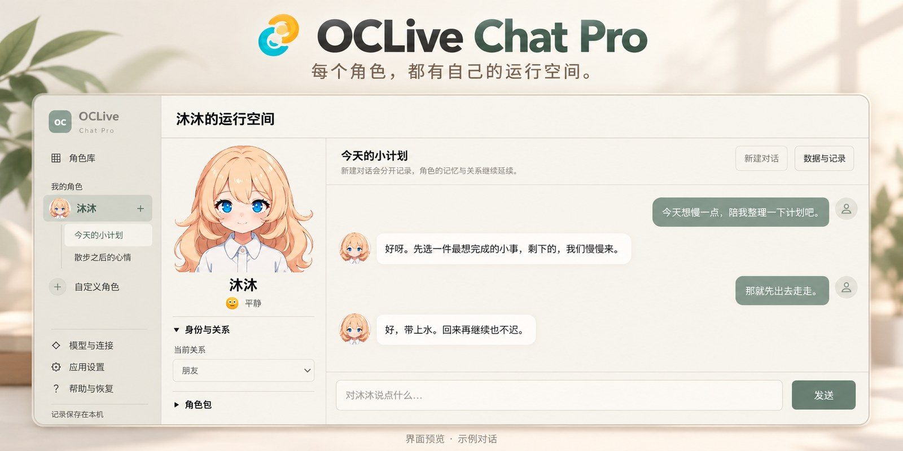
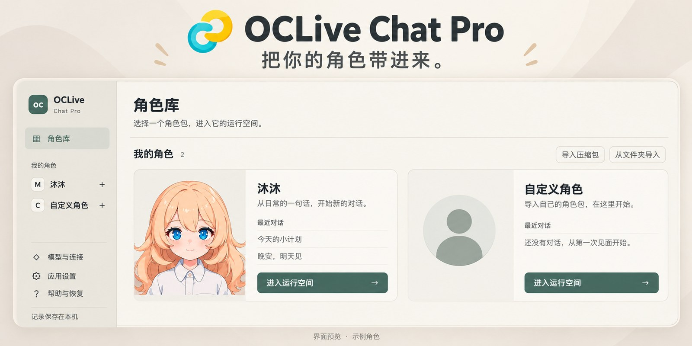
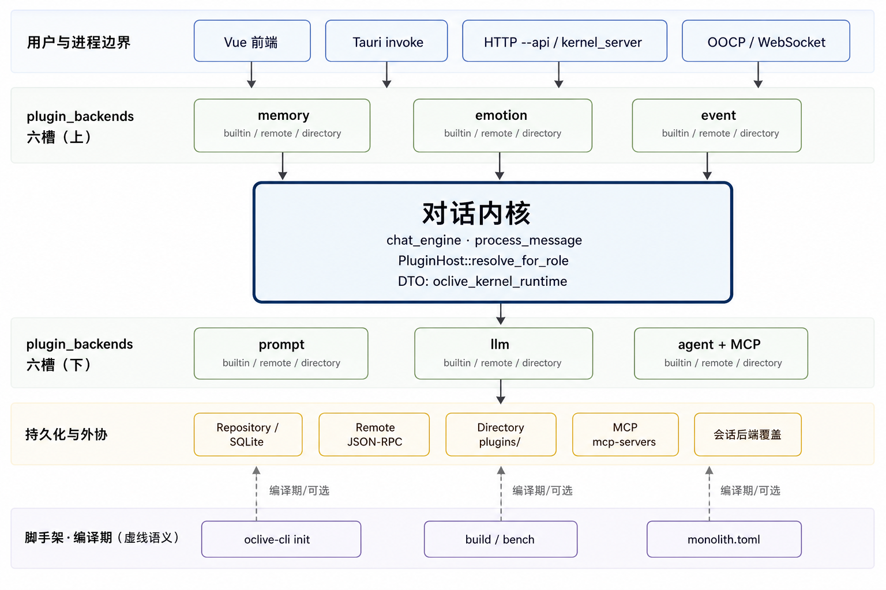
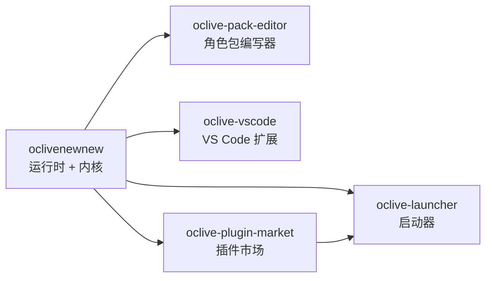

# A.I.Live — 可插拔的角色动脉织机

> 工程仓库 **oclivenewnew**（代号 **oclive**）· 开源 · 本地优先 · **Tauri + Vue 3 + Rust**

[English](README.en.md)

[](https://github.com/linkaiheng2233-cyber/oclivenewnew/actions/workflows/ci.yml)
[](LICENSE)
[](https://github.com/linkaiheng2233-cyber/oclivenewnew/releases)

**版本与内测状态**：[当前事实快照](creator-docs/getting-started/PROJECT_CURRENT_STATUS.md)区分源码、候选包和公开发行；用户可见历史见 [CHANGELOG](CHANGELOG.md)。



*Chat Pro 界面预览：每个角色有自己的运行空间，对话与记忆默认保存在本机。*

> **第一次听说这个项目？先读 [OCLive 是什么（5 分钟）](human-docs/START_HERE.md)。**
> 那一页讲清它是什么、给谁用、不是什么，以及你该从哪条路进来。下面这页留着完整介绍。

## 从哪里开始

| 你的身份 | 入口 | 多久可以开工 |
|----------|------|----------------|
| **第一次听说这个项目** | **[OCLive 是什么（5 分钟）](human-docs/START_HERE.md)** | 5 分钟判断要不要继续 |
| **普通用户**（安装 → 导入包 → 聊天） | [用户手册](creator-docs/getting-started/USER_MANUAL.md) | 15 分钟 |
| 角色包创作者 | [创作者黄金路径](creator-docs/getting-started/CREATOR_GOLDEN_PATH.md) · [学习路径](creator-docs/role-pack/CREATOR_LEARNING_PATH.md) | 约 30 分钟 |
| 主仓开发者 | [人类开发者接手包](human-docs/README.md) | 30 分钟跑通，再按模块开工 |
| Rust Base 模块作者 | [Kernel 基础工程开工](creator-docs/cli/OCLIVE_CLI_GUIDE.md#kernel-base-start) → [Memory 示例](human-docs/modules/slots/memory.md) | 先生成与测试，再按目标接入 |
| 插件 / UI 插件作者 | [插件作者学习路径](creator-docs/plugin-and-architecture/PLUGIN_AUTHOR_LEARNING_PATH.md) | 30–60 分钟 |
| **内核集成方**（无头 / 嵌入式 / 新发行版） | [内核集成路径](creator-docs/getting-started/KERNEL_INTEGRATOR_LEARNING_PATH.md) | 约 1 小时 |
| **贡献代码** | [CONTRIBUTING.md](CONTRIBUTING.md) · [Good second issues](https://github.com/linkaiheng2233-cyber/oclivenewnew/issues?q=is%3Aissue+is%3Aopen+label%3A%22good+second+issue%22) | — |
| AI Agent | [AGENTS.md](AGENTS.md) | 按任务读取 SSOT |

完整索引：[DOCUMENTATION_INDEX.md](creator-docs/getting-started/DOCUMENTATION_INDEX.md)。

文档归属与“当前实现 / 候选 / 计划 / 历史”的区别见 [文档分责](handoff/README.md#documentation-status)。人类和 AI 使用不同阅读入口，但不维护两套架构事实。

---

<!-- ═══════════════════════════════════════════════════════════════════════ -->
<!--  第一部分 · 写给人类                                                    -->
<!-- ═══════════════════════════════════════════════════════════════════════ -->

## 这是什么？

**A.I.Live（OCLive）** 不是“又一个定死的 AI 聊天 App”，也不以集中式平台为本体。它首先是一颗 **用稳定契约组织 AI 角色能力的可嵌入工具内核**：

- 小 Kernel 定义六槽能力契约、必要因果与合法性/错误边界；发行版 Host 负责组合、调度与领域应用（[职责 SSOT](handoff/MODULE_MAP_AND_HANDOFF.md#kernel-responsibilities)）
- **六个稳定能力端口**（记忆、情感、legacy 事件影响、Prompt、LLM、Agent）允许替换实现
- 用 **角色包**（人设、场景、prompts）独立创作与分发内容
- **本地优先**：对话与记忆默认在你机器上；云端 API 可选、BYOK

当前仓库还提供一套完整参考运行时：具体六槽实现、SQLite、Event Ring、设施、HTTP/Tauri 与 Chat Pro。内置角色（如 `distros/chat-pro/roles/mumu`）只是官方示例。参考运行时、发行版、编写器和市场可以使用这颗内核，但都不是最小核心。

> **一句话**：OCLive = **一颗工具内核 + 六个稳定能力端口 + 可选参考装配**。你可以使用整套角色运行时，也可以只取接口、契约和需要的模块，做成自己的工具。“角色的 cargo + docker-compose”是组装与分发类比，不是平台锁定。
>
> 深度定位：[handoff/OCLIVE_POSITIONING_DIFFERENTIATION.md](handoff/OCLIVE_POSITIONING_DIFFERENTIATION.md)

---

## 四个例子（30 秒看懂能做什么）

### 例子 1 · 创作者：做一个可对话 OC

1. 克隆 [oclive-pack-editor](https://github.com/linkaiheng2233-cyber/oclive-pack-editor)（角色包编写器）
2. 按[创作者黄金路径](creator-docs/getting-started/CREATOR_GOLDEN_PATH.md)准备角色包，编辑包内的 `core_personality.txt`，保存到 `distros/chat-pro/roles/你的角色id/`
3. 本仓 `npm run tauri:dev` → 选角色 → 开聊

**不用改** 蓝图 `slot_registry` 或六槽——30 分钟路径见 [创作者黄金路径](creator-docs/getting-started/CREATOR_GOLDEN_PATH.md)。

### 例子 2 · 开发者：只换 LLM，不动人设

在角色蓝图 `pipeline.ocblueprint` 里把 **第 5 模块（llm）** 从 `ollama` 换成 `remote` 或 **目录插件**——人设、记忆、Prompt 公式保持不变。Ollama、llama.cpp 侧车、OpenAI 兼容 API 均可作为 **同一槽的不同插头**。

### 例子 3 · 集成方：同一角色包，多端复用

现有参考 Host、编写器和 CLI 复用角色包加载/校验能力，但各入口支持范围以现行格式和工具契约为准；`manifest.json` / `pipeline.ocblueprint` 不是所有最小角色都必须携带的文件。最小角色只表达 persona + 视觉资产引用，加载准备不等于运行时接入已完成，见 [角色包边界](handoff/ROLE_PACK_BOUNDARY.md)。桌面与 VS Code 共享 **`OCLIVE_ROLES_DIR`** / **`app.db`** 是当前参考 Host 的连续性方案，不等于已实现独立 Portable Memory，见 [跨宿主记忆](creator-docs/role-pack/CROSS_HOST_MEMORY.md)。

### 例子 4 · 模块作者：只写新能力，其余白送

fork `examples/directory-plugin-minimal` 或 `examples/voice-loop-minimal`，实现 **某一槽** 或 **独立通道**（如 TTS）——参考宿主与工具链可以提供人设、UI、对话循环、校验和打包规范。第三方目录插件声明 `process:spawn` / `network:*` / `mcp:*` 等能力时，须 **用户显式授权** 后才会执行（未授权则降级，不 silent 越权）。

入门：[PLUGIN_AUTHOR_LEARNING_PATH](creator-docs/plugin-and-architecture/PLUGIN_AUTHOR_LEARNING_PATH.md) · 权限：[PLUGIN_V1.md](creator-docs/plugin-and-architecture/PLUGIN_V1.md)

---

## 和常见方案有什么不同？

| | LangChain / AI SDK | EchoVessel / 垂直角色引擎 | **OCLive** |
|--|-------------------|---------------------------|------------|
| 你得到什么 | 积木 + 胶水，**写代码**搭链 | **一道做好的菜**——定死的记忆/情感实现 | **标准化厨房 + 装盘规范**——**组装并打包**你自己的引擎 |
| 模块可替换 | 有，但无角色领域契约 | 基本不可换实现 | **六槽 + builtin/remote/directory** 统一契约 |
| 角色内容分发 | 你自己搞 | 绑死在产品里 | **角色包 `.ocpak` / zip**，编写器导出、深链安装 |
| 上限在哪 | 你的代码 | 厂商那一套实现 | **不被单一内置实现焊死**；可按契约换模块与模型 |

和 **SillyTavern** 等「前端壳 + 多后端」方案的对照（常问）：

| | SillyTavern 类 | **OCLive** |
|--|----------------|------------|
| 核心交付 | 聊天 UI + 接各种 API/扩展 | **六槽契约 + 蓝图 + 角色包格式 + 跨端校验** |
| 模块语义 | 扩展各自为政 | **builtin / remote / directory** 统一 backend 面 |
| 分发 | 社区卡片/文件 | **`.ocpak` / zip · SHA-256 · `oclive://` 深链** + 市场站 |
| 编排 SSOT | 多由前端/扩展拼装 | 当前参考 Host 的 Rust **`process_message`**；不是所有 Host 的固定流水线 |

---

## 三发行版（同一内核 · 不同 HostProfile）

当前参考发行版复用 **`process_message`** 和 **`distro.oclive.toml` HostProfile**。这是本仓参考 Host 的维护边界，不要求第三方 Host 采用同一编排；Host 的调度仍须满足六槽契约与必要因果。

| 发行版 | `distro_id` | 形态 | 状态 |
|--------|-------------|------|------|
| **A.I.Live Chat Pro** | `desktop` | 本仓 Tauri 桌面 | 默认角色工作区；[交付状态](creator-docs/getting-started/PROJECT_CURRENT_STATUS.md) |
| **VS Code Flash** | `vscode` | 姊妹仓 [oclive-vscode](https://github.com/linkaiheng2233-cyber/oclive-vscode) | 渗透能力 **插件化**；核心只做轻量聊天宿主 |
| **AI Theater** | `theater` | `distros/theater/` + theater profile | 打包预埋；模式 2 playtest **已解冻** |
| **dev lab** | `desktop-chat` | 实验场 profile | 日常开发 / 低延迟试验 |



*角色库：导入或选择角色包，进入各自的运行空间。*

Profile SSOT：[DISTRO_CAPABILITY_PROFILE.md](creator-docs/kernel/DISTRO_CAPABILITY_PROFILE.md)；三发行版结项约束见 [THREE_DISTRO_KERNEL_CLOSURE.md](handoff/THREE_DISTRO_KERNEL_CLOSURE.md)。

---


## 架构（一句话版）

OCLive 的优化目标不是「把所有能力塞进一个 App」，而是**正交分层**：换 LLM 不动人设、加语音不污染主链、冻结实验能力不影响 Stable 发版。



*内核中心架构：`memory` / `emotion` / `event` 与 `prompt` / `llm` / `agent` 分列对话内核两侧；持久化、目录插件、远程 RPC 与 MCP 通过编译期/可选接线接入。*

**内核**规定六个能力端口的形状，以及少量所有 Host 都必须遵守的底线（失败与错误怎么表达、哪些组合不合法）；**Host** 决定怎么接起来跑一轮对话；**发行版**决定默认装什么。六个端口是 `memory` / `emotion` / `event` / `prompt` / `llm` / `agent`——**都是可选能力，不是固定六步**。

| 想深入了解 | 读 |
|---|---|
| 四层怎么切、为什么这样切（含生活化比喻） | [OCLive 是什么（5 分钟）](human-docs/START_HERE.md) |
| 一轮对话在代码里怎么跑 | [human-docs/01 简架构](human-docs/01_ARCHITECTURE_SIMPLE.md) |
| 对外架构叙述 · 模块编号 · 设施 | [OCLIVE_ARCHITECTURE_OVERVIEW](creator-docs/getting-started/OCLIVE_ARCHITECTURE_OVERVIEW.md) |
| **模块定义 · 槽位关系 · 改动约束（唯一 SSOT）** | [MODULE_MAP](handoff/MODULE_MAP_AND_HANDOFF.md) |
| 角色内容 / 蓝图 / 发行版分责 | [ROLE_PACK_BOUNDARY](handoff/ROLE_PACK_BOUNDARY.md) |
| 单核双态（Monolith 宏核） | [RFC_OCLIVE_MONOLITH_MODE](creator-docs/rfc/RFC_OCLIVE_MONOLITH_MODE.md) |
| 分发机制（OOCP / 签名 / `oclive://` 深链 / 跨宿主记忆 / 内核工厂） | [OCLIVE_ARCHITECTURE_OVERVIEW](creator-docs/getting-started/OCLIVE_ARCHITECTURE_OVERVIEW.md) · [CROSS_HOST_MEMORY](creator-docs/role-pack/CROSS_HOST_MEMORY.md) |
| 路线图与愿景 | [VISION_ROADMAP_MONTHLY](creator-docs/roadmap/VISION_ROADMAP_MONTHLY.md) · [VISION_OPEN_LAB](creator-docs/roadmap/VISION_OPEN_LAB.md) |
| 当前做到哪了 · 欠什么 | [PROJECT_CURRENT_STATUS](creator-docs/getting-started/PROJECT_CURRENT_STATUS.md) · [TECHNICAL_DEBT_INVENTORY](handoff/TECHNICAL_DEBT_INVENTORY.md) |

**首页只放定位与入口，不复述架构长表**（G14 链接代替复制）。模块定义只查 MODULE_MAP，公开契约只查 creator-docs，进度只查技术债。

---

## 三十秒跑通（贡献者）

```bash
git clone https://github.com/linkaiheng2233-cyber/oclivenewnew.git
cd oclivenewnew
npm install
npm run tauri:dev    # 桌面客户端
npm run check        # 日常门禁（build + fmt + clippy + test --lib）
```

| 前置 | 说明 |
|------|------|
| Node.js 22+、Rust stable | Windows 另需 **VS Build Tools（MSVC）** |
| 模型服务 | 编译不要求 Ollama；对话需配置可用的本地服务或云端 API，安装包不附带模型权重 |
| Cargo 产物 | 默认在仓库外 `../oclive-dev-artifacts/oclivenewnew-cargo-target/` |

**安装包说明**：公开可取得的附件以 GitHub [Releases](https://github.com/linkaiheng2233-cyber/oclivenewnew/releases) 实际内容为准。本地内测候选、公开安装器与源码版本分别核对，当前候选的范围和未验边界见[事实快照](creator-docs/getting-started/PROJECT_CURRENT_STATUS.md)。普通用户先读[用户手册](creator-docs/getting-started/USER_MANUAL.md)；源码构建按 [CONTRIBUTING](CONTRIBUTING.md)。

分步说明与验收：[human-docs/02_THIRTY_MINUTE_START.md](human-docs/02_THIRTY_MINUTE_START.md)

---

## 生态（姊妹仓）



| 仓库 | 用途 |
|------|------|
| **本仓** | 桌面运行时、Rust 内核、Chat Pro / Theater 发行版 |
| [oclive-pack-editor](https://github.com/linkaiheng2233-cyber/oclive-pack-editor) | 可视化编辑角色包、导出 zip / `.ocpak` |
| [oclive-vscode](https://github.com/linkaiheng2233-cyber/oclive-vscode) | 编辑器内角色陪伴（渗透能力插件化） |
| [oclive-launcher](https://github.com/linkaiheng2233-cyber/oclive-launcher) | 多发行版入口 · 与市场联动（路线图阶段） |
| [oclive-plugin-market](https://github.com/linkaiheng2233-cyber/oclive-plugin-market) | 插件/包发现 · **`oclive://` 深链** 安装 |

---

## AI / Agent 接手

**GitHub 首页只面向人类读者。** Cursor、Codex 等自动化 Agent 请从专用索引进入，按分类深读 SSOT：

| 文档 | 用途 |
|------|------|
| **[handoff/AI_READING_INDEX.md](handoff/AI_READING_INDEX.md)** | **AI 深读分类目录**（架构 · 契约 · 代码锚点 · 场景路径） |
| [AGENTS.md](AGENTS.md) | 改代码前 **精简门禁**（按任务读取改动边界） |
| [human-docs/ai-package/README.md](human-docs/ai-package/README.md) | AI 包组成与人类文档分工 |

---

## 支持 · 许可

- **Issue**：[GitHub Issues](https://github.com/linkaiheng2233-cyber/oclivenewnew/issues)（`[bug]` / `[feat]` / `[support]` 前缀）
- **许可**：Apache-2.0 · [LICENSE](LICENSE) · [LICENSE_POLICY.md](creator-docs/LICENSE_POLICY.md)
- **行为准则**：[CODE_OF_CONDUCT.md](CODE_OF_CONDUCT.md) · **安全**：[SECURITY.md](SECURITY.md)

---

*人类学习阶梯：[human-docs/README.md](human-docs/README.md)*
